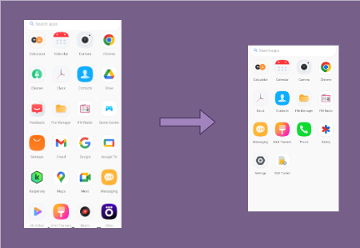

#+TITLE: Lists of Android (bloatware) apps

#+begin_quote
bloatware (/uncountable/)

1. (/computing/, /informal/) Software that is packed with too many
   features and therefore slow or unwieldy; software that is
   inefficiently designed and occupies an excessive amount of memory
   or disk space.
2. (/computing/) *Unwanted pre-installed software, especially on a smartphone*. 

-- https://en.wiktionary.org/wiki/bloatware
#+end_quote

This is an attempt to categorize bloatware apps that are installed on
Android phones.

Based on [[https://github.com/Universal-Debloater-Alliance/universal-android-debloater-next-generation][UAD-ng]].

* Objectives

- Never brick your phone.
- Do not uninstall apps that are not immediately recognized as bloatware.
- Do not attempt to be a security expert (we are not).
- Consider uninstalling Google Play and using F-Droid instead: https://f-droid.org

* File organization and naming conventions

The lists are in YAML files inside [./bloatware/](./bloatware) directory.

Most YAML files are named using the first two elements of the Android app ID.

* Entry schema

Each YAML file is a list of entries. Every entry must have at least
=id=, =description=, and =removal=:

#+begin_src yaml
- id: com.asus.alwayson
  description: |-
    Always-on Display
    AOD will be not available after remove.
  removal: caution
  consequence: feature
  confidence: community
  suggestions: []
#+end_src

** =removal= values

  | Value       | Meaning                                              |
  |-------------|------------------------------------------------------|
  | =safe=      | No known issues                                      |
  | =caution=   | May break a minor or obscure feature                |
  | =risky=     | May break important functionality                   |
  | =critical=  | Bootloop, bricking, or dead device; do not remove    |
  | =unknown=   | Not yet assessed                                     |

** Optional fields

=removal= alone is severity. These fields add the other dimensions that
matter when deciding whether to remove a package:

  | Field        | Values                                        | Meaning                                             |
  |--------------|-----------------------------------------------|-----------------------------------------------------|
  | =consequence= | =none=, =feature=, =degraded=, =brick=        | What breaks if you remove it (FMEA failure effect)  |
  | =confidence=  | =confirmed=, =community=, =assumed=           | How sure we are (tested vs. inferred)               |
  | =suggestions= | list of package IDs                           | Alternatives to install instead                     |

=consequence= is only meaningful for =caution=, =risky=, and =critical=;
for =safe= entries it is implied to be =none=. =confidence= is optional;
absent means no claim either way.

** Uniqueness

=id= must be unique across all files in [./bloatware/](./bloatware).
Do not create a second entry for the same package. If a package behaves
differently per device, use =variants= on a single entry instead.

* Per-device variants

A single =removal= value assumes the package behaves the same on every
device. In practice, an app can be safe on one phone and brick another.
Use =variants= to express that. The base =removal= applies when no
variant matches.

#+begin_src yaml
- id: com.oneplus.loguploader
  description: |-
    Logging app for diagnosis/troubleshooting when the SIM card state changes.
  removal: safe
  variants:
    - ro.product.manufacturer: [OnePlus]
      ro.build.version.sdk: ">= 34"
      removal: safe
      note: "Safe on Android 14 custom ROMs"
    - ro.product.manufacturer: [OnePlus]
      ro.build.id: ["OP5253_221205.003"]
      removal: critical
      note: "Hard dependency on this specific OxygenOS 14 build"
#+end_src

** Match rules

- Within a variant, keys are ANDed; within a key, values are ORed.
- Unspecified keys are wildcards (match anything).
- Priority: the variant with the most keys wins. If none match, the
  base =removal= is used.

** Variant keys

Keys are ADB property names, read with =adb shell getprop= at runtime.

  | ADB property             | Match style     | Notes                                        |
  |--------------------------|-----------------|----------------------------------------------|
  | =ro.product.manufacturer=  | list / exact    | enumerable, stable                           |
  | =ro.product.model=         | list / exact    | opaque device code; see below                |
  | =ro.build.version.sdk=     | range           | API level, most precise OS indicator         |
  | =ro.build.version.release= | range           | human-readable Android version               |
  | =ro.build.id=             | exact list      | per-firmware-build; use sparingly            |

Ranges use =>=, ==, =<=, or a single value for exact match.

** Device codes

=ro.product.model= returns opaque codes, not marketing names:

  | Code       | Device          |
  |------------|-----------------|
  | =DE211=    | OnePlus 12      |
  | =SM-S918B= | Galaxy S23 Ultra |
  | =SM-A037F= | Galaxy A03      |

Run =adb shell getprop ro.product.model= on your device to find its code.

* Contributing

Please consider adding any missing apps.

1. Check if app is listed in this repository
   #+begin_src
     $ grep -r APP_ID .
   #+end_src
2. Add package entry to appropriate file in following format:
   #+begin_src yaml
     - id: APP_ID
       description: |
         Describe what this package does.
       removal: safe # If this app is obviously not needed.
   #+end_src

** Old removal values

Existing entries may still use the old scale (=recommended=, =advanced=,
=expert=, =unsafe=). These are being migrated to the new scale:

  | Old          | New         |
  |--------------|-------------|
  | =recommended= | =safe=      |
  | =advanced=   | =caution=   |
  | =expert=     | =risky=     |
  | =unsafe=     | =critical=  |

Some =advanced= entries are really "safe but replaceable" rather than
risky. When you reclassify one, move it to =safe= and add the
alternative to =suggestions=.
